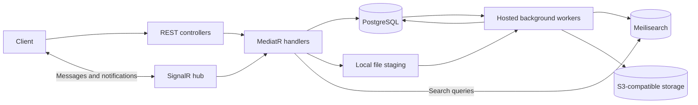

# ChatEngine

A marketplace backend built with **ASP.NET Core, SignalR, and PostgreSQL**. Users can manage product listings, message each other, and negotiate sale offers within a conversation. Meilisearch provides user and product search, while background workers handle search indexing, staged image uploads, and offer lifecycle updates.

This is an actively developed backend project. It includes REST endpoints, a SignalR hub, database migrations, and integration tests; it does not include a frontend. The implemented negotiation flow is for sales. Bartering is represented in the domain model but is not yet a complete workflow.

## Features

- **Accounts and authentication:** registration, login, password changes, BCrypt password hashing, and JWT bearer authentication for protected endpoints and the SignalR hub.
- **Real-time conversations:** direct messages, conversation loading, room initialization, and notifications through room and user-specific SignalR groups.
- **Product inventory:** create listings, update details and stock, change listing status, and retrieve product details or the current user's listings.
- **Sale negotiations:** propose, counter, accept, and decline offers, with persisted offer events, inventory reservation logic, and chat messages describing offer changes.
- **Search:** paginated user and product search through Meilisearch, synchronized from database outbox entries.
- **Background processing:** hosted workers for search synchronization, image uploads with retry tracking, offer expiration, and automatic sale completion.
- **Diagnostics:** Serilog console and file logging, HTTP exception handling, a SignalR exception filter, and rate limiting on selected endpoints.

## Technology

| Area | Tools |
| --- | --- |
| API and real-time communication | C#, .NET 10, ASP.NET Core, SignalR |
| Persistence | PostgreSQL 16, Entity Framework Core, Npgsql |
| Application logic | MediatR commands, queries, pipeline behaviors, and strategy interfaces |
| Authentication | JWT bearer tokens, BCrypt.Net |
| Search | Meilisearch |
| File storage | AWS S3 SDK with an S3-compatible endpoint; SeaweedFS for local development |
| Public identifiers | Hashids.net |
| Testing | xUnit, WebApplicationFactory, SignalR client, Respawn |
| Development infrastructure | Docker Compose, Serilog |

## How it fits together



The API and workers run in the same application process. Controllers and hub methods dispatch requests to handlers, while pipeline behaviors provide shared checks for applicable requests, such as product ownership and offer existence.

Three implementation choices are central to the project:

1. **Database-backed search synchronization.** Account and product changes write outbox entries alongside database updates. A worker polls those entries and submits documents to Meilisearch. Search is eventually consistent: a successful write may take a few seconds to appear in results.
2. **Staged file uploads.** Files are first saved locally, with upload work recorded in `UploadEntries`. A worker uploads the file, updates its associated photo record, and removes the staged copy after success. The database and object store do not share a transaction, so recovery and cleanup remain important areas of development.
3. **Offers as domain actions.** Sale offers have their own state and event history. Handlers update offers and inventory inside database transactions and produce messages for the conversation.

Hashids encode public identifiers; authorization still depends on checking the authenticated user's access to the underlying resource.

## Run locally with Docker

### Prerequisites

- Docker Engine with Docker Compose.
- Git.
- The .NET 10 SDK if you want to build the application or run tests outside Docker.

```bash
git clone https://github.com/lenardmagat/ChatEngine.git
cd ChatEngine
mkdir -p storage default-assets
```

The root `.env`, `storage/`, and `default-assets/` paths are ignored by Git. Create the configuration below before starting the stack.

### 1. Configure the application

Create `.env` in the repository root:

```dotenv
JWT_SECRET_KEY=replace-with-a-random-signing-key
JWT_ISSUER=ChatEngine
JWT_AUDIENCE=ChatEngineClient
HASHID_SALT=replace-with-a-random-salt
Hashids__MinHashLength=12

DB_CONNECTION_STRING='Host=chat-db;Port=5432;Database=chat_system_db;Username=lenard_admin;Password=super_secure_password123'
MEILISEARCH__URL=http://meilisearch:7700
MEILISEARCH__MASTERKEY='masterKey123_ChangeMeInProd!'

Storage__AccessKey=chatengine-local
Storage__SecretKey=chatengine-local-secret
Storage__InternalEndpoint=http://seaweedfs:8333
Storage__PublicEndpoint=http://localhost:8333
Storage__Bucket=marketplace
```

Use `openssl rand -hex 32` to generate a signing key and run it again for a separate Hashids salt. Replace the two placeholders above with those values.

The database credentials and Meilisearch key in this example match the development defaults in [docker-compose.yml](docker-compose.yml). The storage credentials must match the next file. Keep these development settings local; use separate credentials for any deployment.

Compose maps variables such as `JWT_SECRET_KEY` to the application's .NET configuration keys, such as `Jwt__Key`. Those aliases are Compose-specific: a direct `dotnet run` needs `Jwt__Key`, `Jwt__Issuer`, `Jwt__Audience`, and `Hashids__HasherSalt`, together with the database, search, and storage settings. When running the API on the host, use `localhost:5433` for PostgreSQL, `http://localhost:7700` for search, and `http://localhost:8333` for storage instead of Compose service names.

### 2. Configure local object storage

Create `storage/s3.json`:

```json
{
  "identities": [
    {
      "name": "api",
      "credentials": [
        {
          "accessKey": "chatengine-local",
          "secretKey": "chatengine-local-secret"
        }
      ],
      "actions": ["Admin", "Read", "Write", "List", "Tagging"]
    },
    {
      "name": "anonymous",
      "credentials": [{"accessKey": "", "secretKey": ""}],
      "actions": ["Read:marketplace"]
    }
  ]
}
```

This grants anonymous read access to the local `marketplace` bucket so image URLs can be displayed by clients. The API credentials are used for uploads.

Place a placeholder profile image at `default-assets/somi.png`, matching the current user-search fallback. You can add other default images to that directory. The initialization service creates the `marketplace` bucket and copies the directory into its `defaults/` prefix; keep `Storage__Bucket=marketplace` unless you also update that service.

### 3. Start the services

Start the dependencies first and wait for PostgreSQL to become healthy:

```bash
docker compose up -d --wait chat-db meilisearch seaweedfs
docker compose run --rm storage-init
docker compose up -d --build chat-api
docker compose logs -f chat-api
```

| Service | Local address |
| --- | --- |
| REST API | `http://localhost:5000` |
| SignalR hub | `http://localhost:5000/ChatHub` |
| PostgreSQL | `localhost:5433` |
| Meilisearch | `http://localhost:7700` |
| S3 endpoint | `http://localhost:8333` |

The application attempts to apply EF Core migrations at startup. Check the logs for migration errors: the current startup code logs failures and continues. There is no frontend or Swagger UI mapped at `/`.

Uploaded files are staged under `Uploads/staging` relative to the application directory. In the API container this is `/app/Uploads/staging`. The current Compose file does not mount that directory as a volume, so recreating the container can lose pending files. Persist it before relying on uploads across container replacement.

Stop the stack with `docker compose down`. Named database, search, and object-storage volumes remain unless explicitly removed.

## API examples

Register an account using form data:

```bash
curl -i http://localhost:5000/Account/Create \
  -F 'Username=demo_user' \
  -F 'password=DemoPassword123!'
```

Log in using JSON:

```bash
curl http://localhost:5000/Account/Login \
  -H 'Content-Type: application/json' \
  -d '{"username":"demo_user","password":"DemoPassword123!"}'
```

The response includes `accessToken` and `rawToken`. Use `accessToken` as the bearer token for protected requests:

```bash
curl http://localhost:5000/Inventory/ProductsSummary \
  -H 'Authorization: Bearer <accessToken>'
```

Search accepts query parameters. Omitting pagination uses page `1` and page size `10`:

```bash
curl 'http://localhost:5000/Feature/Search?term=demo&target=Users'
curl 'http://localhost:5000/Feature/Search?term=keyboard&target=Products&page=1&pageSize=10'
```

`Users` and `Products` are the currently registered search targets. Product search returns active listings with available stock. Allow time for background indexing after creating or changing records.

### REST endpoints

| Method | Path | Authentication | Purpose |
| --- | --- | --- | --- |
| POST | `/Account/Create` | Public | Register; form data with an optional profile image |
| POST | `/Account/Login` | Public | Log in; JSON request |
| PATCH | `/Account/AccountUpdate-ChangePassword` | Bearer token | Change password |
| POST | `/Inventory/CreateProduct` | Bearer token | Create a listing; currently accepts JSON |
| PATCH | `/Inventory/UpdateProductDetails` | Bearer token | Update listing details and stock |
| PATCH | `/Inventory/UpdateProductStatus` | Bearer token | Change listing status |
| GET | `/Inventory/ProductDetails/{productId}` | Bearer token | Retrieve product details |
| GET | `/Inventory/ProductsSummary` | Bearer token | List the current user's products |
| GET | `/Feature/Search` | Public | Search users or products |

For registration with a profile image, include both `FileName` and `ProfilePicture` form fields. Product image binding is still being revised: the product request DTO includes an `IFormFile`, but its controller currently binds the request from JSON.

### SignalR hub

Connect a SignalR client to `/ChatHub` with a JWT using the client's access-token provider. The server also accepts the `access_token` query parameter on this hub path.

| Client method | Purpose |
| --- | --- |
| `InitializeChat` | Resolve or initialize a direct conversation |
| `SendMessage` | Send a message to a user or room |
| `LoadChats` | Load the caller's conversations |
| `ChatDisconnect` | Request removal from a chat group |
| `ProposedOffer` | Propose a sale offer |
| `CounterOffer` | Counter an existing offer |
| `AcceptOffer` | Accept an offer |
| `DeclineOffer` | Decline an offer |

Server events include `ChatId`, `NewMessage`, `NewMessageNotification`, `Load Conversation`, and offer response events. See the [hub implementation](EndPoints/Hub) and [request DTOs](Datas/DTOs) for exact payloads and event names.

## Build and tests

Build the API with the .NET 10 SDK:

```bash
dotnet restore WebApplication1.csproj
dotnet build WebApplication1.csproj --no-restore
```

[ChatEngine.Tests](ChatEngine.Tests) contains integration tests for registration, login, password changes, inventory creation and updates, SignalR authentication, messaging, and conversation loading. They use `WebApplicationFactory` with real PostgreSQL, Meilisearch, and S3-compatible storage.

**Use dedicated test resources.** Test setup resets database data, deletes objects from `marketplace-test`, and clears the test search documents.

The expected test environment is:

| Dependency | Test configuration |
| --- | --- |
| PostgreSQL | `localhost:5433`, database `chat_system_db_test` |
| Meilisearch | `http://localhost:7701` |
| S3 storage | `http://localhost:1112`, bucket `marketplace-test` |

1. Start PostgreSQL with the root Compose file and create `chat_system_db_test` once, using the same database user as the development configuration:

   ```bash
   docker compose up -d --wait chat-db
   docker compose exec chat-db createdb -U lenard_admin chat_system_db_test
   ```

2. Start the separate test search and storage services:

   ```bash
   docker compose -p chatengine-tests -f ChatEngine.Tests/docker-compose.yml up -d meilisearch seaweedfs
   ```

3. Check [appsettings.Testing.json](ChatEngine.Tests/appsettings.Testing.json), the [test storage credentials](ChatEngine.Tests/storage/s3.json), and [TestFactory.cs](ChatEngine.Tests/TestFactory.cs). The database connection is also hard-coded in the factory, so changing only the JSON file does not change the reset target. Wait for storage to be ready before running tests; the test helper creates `marketplace-test` if it does not exist.
4. Run:

   ```bash
   dotnet test ChatEngine.Tests/ChatEngine.Tests.csproj
   ```

**Current test limitation:** the account test helper still calls `/API/Account/...`, while the current controller uses `/Account/...`. Those paths need to be aligned before the affected tests can pass.

## Project layout

```text
ChatEngine/
├── BackGroundWorkers/          # Upload, search sync, expiration, and completion workers
├── Datas/
│   ├── DTOs/                   # Request, response, and search document contracts
│   └── Models/                 # Users, products, chats, offers, photos, and work entries
├── EndPoints/
│   ├── Hub/                    # SignalR chat and offer methods
│   └── Routers/                # Account, inventory, and search controllers
├── Infrastructure/
│   ├── DataBase/               # DbContext, design-time factory, staging, and storage
│   ├── Middleware/             # Dependency registration and request handling
│   └── Security/               # Authentication, hashing, options, and result types
├── Services/
│   ├── EventHandlers/          # Application handlers and strategies
│   ├── EventsServices/         # Shared services and pipeline behaviors
│   ├── Interfaces/             # Service and strategy contracts
│   └── SystemEvents/           # Commands and queries
├── Migrations/                 # EF Core schema history
├── ChatEngine.Tests/           # Integration tests and test infrastructure
├── Dockerfile
├── docker-compose.yml
└── Program.cs
```

## Current development priorities

- Align tests and request contracts with the current routes, including product image uploads.
- Strengthen upload recovery, cleanup, and durable staging; database rollback cannot undo an object-store write.
- Expand authorization, concurrency, and failure-path tests for room access, offer transitions, and inventory changes.
- Complete the barter workflow and the unimplemented message/channel search targets.

Automatic sale completion currently uses a 30-minute timer after acceptance. It is an application state transition, not payment processing or proof of delivery.
